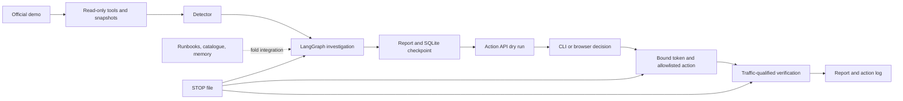

# Architecture and verification status

The operator owns fault injection. The investigator receives telemetry from the
unmodified OpenTelemetry Demo, not the injector's journal. Status below describes
the `docsport` snapshot and its retained bundles.

| Component | Responsibility | Implementation / evidence |
|---|---|---|
| `faultctl/` | Injection, overlay, reset/read-back | Built; [BUILD_01B](../BUILD_01B.md); generic grammar and external reset require fold |
| `tools/` | Metrics, traces, logs, containers, action history; resolution | Built; `python -m tools.cli health_table`; five read timings passed preflight |
| `detect/` | Thresholds, baseline, debounce, watcher | Built; idle fixture quiet; outage, traffic-state, CLIENT-span and latch fixes still xfail |
| `agent/` | Investigation, evidence, policy and response graph | Built; [payment r6](../reports/payment-failure-r6/report.json), [recommendation r3](../reports/container-stopped-r3/report.json); current-prompt reruns not verified |
| `action_api/` | Preview, approval, idempotency, STOP, verification | Built; [payment loop r3](../reports/payment-failure-loop-r3/report.json), [restart loop r1](../reports/container-stopped-loop-r1/report.json), both test-approved |
| `ui/` | Mock/real Control Room and shared pending checkpoint | Built; [loop r9](../reports/payment-failure-loop-r9/hands-rehearsal.json) exercised the real browser endpoint through automation |
| `schema/`, `reports/` | Internal schema, validator, JSON/Markdown, export adapter | Built; `python -m schema.validate "reports/*/report.json"`; organiser schema not verified |
| `knowledge/`, `memory/` | Procedures, catalogue, retrieval, incident summaries | Built on separate knowledge branch, absent here; corrected merged/live behavior not verified |
| `eval/` | Explicit case scoring/calibration | Built; `python -m eval.calibration --help`; no held-out accuracy claim |
| `scripts/` | Both shells, readiness, morning, Linux gate | Built; help/preview and read-only preflight exercised; no mutating rehearsal this session |
| Reviewer model / Kubernetes scaling | Optional review / scaling | Not implemented; Compose scaling explicitly unavailable |

The graph starts with health and requests bounded tools, retaining reasons and
resolvable evidence. Twelve tool reads do not establish a wall-clock or LLM-call
deadline: guaranteed terminal reports and these limits are fold requirements.
Low support or incomplete coverage must escalate. Code selects remedies from
closed component/category labels; prose and retrieval cannot authorize execution.

**Independence counts observations, not APIs.** Trace IDs, span IDs and spanmetrics
share a trace family. Runtime CPU/memory, container lifecycle and application logs
provide other observations. Duplicate Docker/OpenSearch logs count once; a span
and log for the same request remain correlated. Health tables add no family.
The snapshot still classifies spanmetrics as generic metrics, so historical
confidence does not establish compliance with the corrected two-family rule.
`test_spanmetrics_do_not_double_count_traces` is a strict xfail. Log-body mentions
do not prove ownership: require the emitting component or a structured service
field. Signal magnitude needs a service-relative baseline.

SQLite holds approval interrupts. CLI and browser compete for the same response;
one single-use token binds report, action, operator and world. The required record
is `approved_by`, `surface=cli|browser|test`, `mode=live|test`, timestamp and token
ID. Test approvals render **Approved in TEST mode by the test harness (not a human)**.
Historical reports omit provenance and can misleadingly name Yash; their runner
and action-log records are authoritative. R3/restart-r1 used test approval; r4 used
`--reject`; r9 used browser automation. Human approval is not verified. The fold
owns schema/renderer correction and truthful historical re-rendering.

STOP blocks new changes and cancels waits, but cannot undo Docker's accepted
restart. Verification lasts at least 180 seconds. Fold requirements: two fresh
samples, at least 20 requests and 30% of the affected service's baseline traffic;
unknown telemetry/traffic escalates without automatic rollback. Restoring a failure
switch must be explicit in the approved rollback meaning. Historical r7/r8 rollback
on lost traffic is a safety finding, not the target behavior. See the measured
limitations in [EVALUATION_NOTE.md](EVALUATION_NOTE.md).
