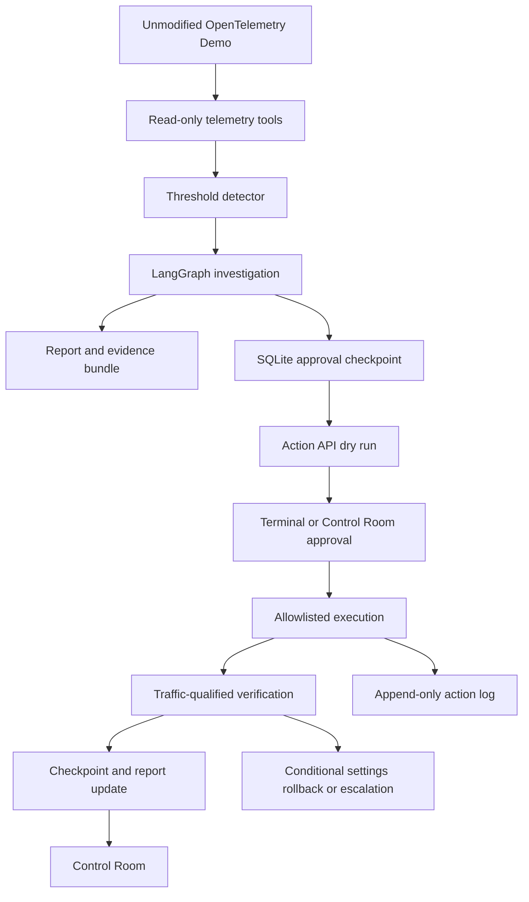

# Architecture

The brain, hands and Control Room run in one checkout. Live verification is
recorded separately from implementation status below.

## Components and boundaries

| Component | Responsibility |
| --- | --- |
| `faultctl/` | Operator-only injection/reset, scoped Docker changes and repository-owned overlay; official demo source stays unmodified |
| `tools/` | Capped metrics, traces, logs, container state and action history; redaction, evidence IDs, immutable snapshots and resolution |
| `detect/` | Telemetry thresholds, debounce, alert persistence and investigation startup; no injection-state reads |
| `agent/run.py`, `graph.py` | Health first, one structured tool per step, diagnosis, evidence confidence, symptom coverage and risk assessment |
| `agent/respond.py` | Shared LangGraph response tail, canonical checkpoint checks, terminal/browser arbitration, approval, execute, verify and saved report update |
| `action_api/` | Localhost write boundary: allowlist, authoritative preview, durable tokens/idempotency, STOP, cooldown, executors, verification and rollback |
| `ui/`, `action_api/ui_routes.py` | Static Control Room and same-origin API; real mode mounts in the Action API, mock mode keeps decisions in memory |
| `schema/`, `reports/` | Closed schema and cross-field validation; JSON/Markdown bundles, evidence manifest and action-log excerpts |
| `scripts/checkpoint3.ps1` | Complete operator rehearsal with qualified before/after windows, terminal/browser decision, final report and cleanup |
| `eval/` | Explicit offline case scoring and calibration summaries; never imported by the investigator |

## One incident

1. The detector observes a threshold crossing and writes an alert. Organiser
   incidents enter through exactly this telemetry path; the injector is optional.
2. The investigation starts with all-service health, then chooses one read per
   model step. Twelve calls bound the investigation. Tools reject control-setting
   disclosure and retain sanitized observations.
3. Code checks evidence provenance, component support and source independence;
   final confidence is `min(model, evidence)`. The dependency graph explains caller
   symptoms without turning one dependency failure into unrelated causes.
4. Risk assessment runs before proposal. Code derives allowlisted actions from
   causes. Low confidence, independent multi-service faults, data risk and
   unsupported fixes escalate with no action.
5. The response graph performs a real dry run, then persists an `approval`
   interrupt in `runs/checkpoints.sqlite`, keyed by `run_id`. The saved report is
   a sanitized presentation; the private canonical checkpoint binds tokens.
6. A terminal `y`/typed `yes` or a browser decision resumes that checkpoint.
   Both surfaces recheck the current world and compete for the same response
   lock. The winner executes once; the other observes the result. Human reading
   time does not hold the execution lock. Each action needs its own decision.
   A browser continuation that begins before the terminal enters the responder
   is joined under the same lock, so terminal cleanup waits for verification.
7. Verification samples every 30 seconds for at least 180 seconds. Every original
   alert signal must satisfy its recovery predicate on two consecutive samples,
   with at least 20 measured frontend requests and a running load generator.
   Final JSON, Markdown, evidence and the action-log excerpt are saved together.

The mentor/demo wrappers capture the operator's initial swarm, use 20 Locust
users/spawn 5 for the run, and restore the prior swarm before final reset and
clearance. The standalone runner changes load only with explicit `--load-users`.
This setup avoids a measured five-user alert timeout and is retained in bundle
metadata; it supplies no diagnosis or synthetic recovery observation.
After an explicit workload change, only the detector's frontend traffic baseline
is replaced using the final two measured qualified clean samples. Its historical
value, new value, sample times and metric evidence are saved. Other anomalies
and thresholds continue to refuse an unhealthy baseline.

## Cause taxonomy and evidence

Categories are `application_flag`, `container_down`, `restart_loop`,
`dependency_unavailable`, `network`, `resource_starvation`, `load`, and `unknown`.
An exited dependency is a `container_down` cause: `valkey-cart` is the component,
`cart` is the symptom owner. Dependency wording describes that relationship;
it does not require a second cause. Connection errors and exited state provide
independent application/runtime observations. Repeated Docker lifecycle fields
and duplicated OpenSearch/stdout logs do not create independent sources.

Evidence IDs name traces/spans, metric points, OpenSearch/Docker logs, container
fields and action-log lines. The resolver checks live data first, then retained
run/bundle snapshots with checksums and explicit source labels. Snapshot evidence
does not establish current recovery. Model identifiers come from `.env`; the
report records the model actually used and sanitized usage/cost metadata.

## Safety and persistence

The allowlist contains `toggle_flag`, `restart_service` and `throttle_load`.
Unknown operations return `FORBIDDEN_OPERATION`; Compose scaling returns
`NOT_AVAILABLE_ON_COMPOSE`. Diagnostic modules cannot run executor commands or
read injection journals. Only the narrow setting adapter reads state for approved
writes, hashing and rollback.

Approval tokens expire after ten minutes and bind plan, report, operator and
world-state hashes. Durable attempt records make idempotency survive restarts.
One action/verification sequence is active at a time, and each target has a
five-minute cooldown. Changed worlds, interrupted/uncertain attempts and stale
approvals fail closed.

STOP is one root file shared by the detector, agent, Action API and injector.
It blocks new changes and cancels verification waits; rollback also obeys it.
Pending approvals persist an aborted checkpoint/report without an attempt;
active responses retain their lock and cancel at the next safe check.
Operator reset remains available. The clear phrase is exactly
`I confirm the incident is over`. STOP cannot reverse a command already accepted
by Docker. Reversible settings roll back only if the relevant world still matches;
restart non-recovery escalates because prior process state cannot be restored.

The append-only audit exports token fingerprints, never usable tokens. Private
SQLite records under ignored `runs/` retain token/rollback state. The API binds
to loopback. Control Room routes reject cross-origin browser mutations; the
native API trusts the localhost same-user boundary. It is not a hosted
multi-user authentication service.

## Implementation and live status

| Part | Status and evidence |
| --- | --- |
| Demo bring-up, injection/reset | Built and exercised live; [BUILD_01B](../BUILD_01B.md) |
| Telemetry tools, redaction and evidence resolution | Built and exercised in retained diagnostic runs; source/snapshot regressions |
| Detector, investigator, risk and reports | Built; payment and stopped-recommendation diagnostic runs in [BUILD_04](../BUILD_04.md) |
| Dependency evidence scoring | Built and regression-tested; historical cache runs remain honest 0.55 escalations |
| Action API, responder and execution | Built and verified live for [payment toggle/recovery](../reports/payment-failure-loop-r3/report.json) and [recommendation restart/recovery](../reports/container-stopped-loop-r1/report.json), with explicit developer test approval; timings in [BUILD_05](../BUILD_05.md) |
| Rejection without mutation | Verified live: [payment-failure-loop-r4](../reports/payment-failure-loop-r4/report.json); before/after world hashes match, no execute event |
| Mid-run STOP | Verified live: [payment-failure-loop-r5](../reports/payment-failure-loop-r5/report.json), aborted after execution; verification and rollback refused, operator cleanup measured separately |
| Conditional settings rollback | Built and regression-tested; live acceptance tracked in [BUILD_05](../BUILD_05.md) |
| Real Control Room and checkpoint reconciliation | Built; live browser acceptance tracked in [BUILD_06](../BUILD_06.md) |
| Mock Control Room | Built with isolated state and no executor/recovery simulation |
| Full-loop mentor and demo scripts | Built; before/after measurements and run timings retained per bundle |
| Offline calibration utility | Built; historical tuning data are limited and are not held-out accuracy |
| Reviewer model, adaptive memory, prevention, Kubernetes scaling | Not implemented |
